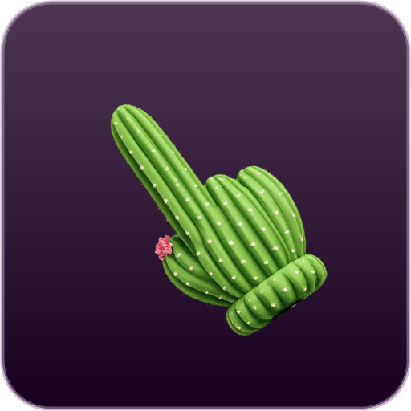

# TinyHand for Windows

**English** | [Deutsch](README.de.md)

[](https://github.com/zebrajaeger/tinyhand-windows/releases)
[](https://github.com/zebrajaeger/tinyhand-windows/releases)
[](./LICENSE)

A tiny hand that points at things on your Windows screen. Highlight a detail,
draw on the desktop, or add arrows during a presentation or screen recording.

This is a native Windows port and fork of **[TinyHand by nilbuild](https://github.com/nilbuild/tinyhand)**.
The original macOS app, concept, hand artwork and sounds come from that project.
For the macOS version, visit [nilbuild/tinyhand](https://github.com/nilbuild/tinyhand)
or [tinyhand.app](https://tinyhand.app).

[](https://github.com/zebrajaeger/tinyhand-windows/releases)

## Download and run

1. Open the [Windows releases](https://github.com/zebrajaeger/tinyhand-windows/releases).
2. Download `TinyHand-Windows-<version>-win-x64.zip` from the release assets.
3. Extract the ZIP and run **`TinyHand.Windows.exe`**.

Requires **Windows 10/11 x64**. The app is portable: no installer, administrator
rights or separate .NET installation are needed. A SHA-256 checksum is included
with each Windows release. GitHub's automatic source-code archives do not contain
the executable.

The application is **unsigned**, so Windows SmartScreen may show a warning.

After launch, look for the hand icon in the system tray, possibly under the hidden
icons. The pointer starts **off**. The tray icon follows your selected hand style;
in laser mode it shows the lavender hand. The EXE uses the tilted cactus README logo as its icon.

## Use

| Action | Result |
|---|---|
| **Ctrl+Alt+H** or left-click the tray icon | Turn the pointer on or off |
| Right-click the tray icon | Choose a hand or laser, pointer size, tap sound, or quit |
| Left-click while the pointer is on | Show a tap effect and optionally play a sound |
| Hold the left mouse button and drag | Draw on the screen |
| Hold **Shift when releasing** the left mouse button | Add an arrowhead |
| **Ctrl+Alt+X** | Clear the drawing |
| **Esc** | Turn the pointer off without deleting annotations; cancel a pending text |

**While the pointer is on, the overlay blocks clicks and scrolling in applications
underneath.** Turn it off with **Esc** or **Ctrl+Alt+H** before using other apps or
opening the tray menu. Ordinary keyboard input is not blocked and can still reach
the previously focused application.

## Annotations

Turning the pointer off keeps completed lines and text visible and click-through.
Normal clicks and scrolling reach applications underneath. **Ctrl+Alt+X** or
**Alles löschen** removes all annotations. Quitting or changing monitor layout
also discards them; annotation content is not saved.

Choose **Zeichenfarbe** in the tray for new elements; existing ones keep their
color. **Text platzieren** waits for a position click, then opens a focused editor.
Enter commits; Esc or switching applications cancels. Only this explicit editor
consumes typing. Text is single-line (up to 500 Unicode scalar values), uses a
fixed font/size and cannot be moved or edited after commit. Clear and re-enter to
correct it.

**Screenshot in Zwischenablage** copies the full monitor currently under the mouse
to the clipboard, including completed annotations but without TinyHand's hand,
laser or tap animation. Paste into an image-capable application. No file is saved
automatically. Finish or cancel pending text/drawing first. Protected windows,
secure desktops and some fullscreen content may be blank or unavailable.
An optional [Stream Deck plugin](stream-deck/README.md) provides seven actions with
actual state feedback. It is built/installed separately and requires Stream Deck
7.1+ on Windows. Local package validation is automated; physical hardware acceptance
is still pending. The app remains usable without the plugin.

## Features

- Built-in hand styles and a laser dot.
- Dynamic hand tilt with smooth grip tracking; the fingertip stays on the cursor.
- Screen drawing, arrows and an animated tap indicator.
- Three pointer sizes and six selectable tap sounds with previews.
- Saved hand, size and sound preferences. Tap sounds are off by default.
- Optional **Mit Windows starten** (start with Windows) in the tray menu, for the
  current user without administrator rights. The pointer still starts off.
- An overlay on each monitor.
- A silent audio keep-alive while the pointer and tap sounds are enabled, to avoid
  losing short sounds when a headset wakes up between clicks.

Settings are stored in `%USERPROFILE%\.config\TinyHand\settings.json`.
Audio diagnostics are stored alongside them in `audio.log`.
The pointer always starts off, even when preferences are restored.

Autostart registers the current EXE location for your Windows user. Keep the
portable app in a permanent folder rather than a temporary extraction directory.
If you move it, disable and re-enable **Mit Windows starten** from its new location.
Turn the option off before deleting the app. Windows Task Manager can also disable
startup apps independently of the tray setting.

## Current limitations

This Windows port does not yet include all features of the original macOS app:

- No installer, code signing or auto-updater.
- No floating toolbar, full settings window, custom hands or URL automation.
- No click-through pointing mode (passive annotations are click-through) or separately extended arm/stick segment.
- Monitor-layout changes clear the current drawing. Test mixed-DPI setups before
  an important presentation.
- Secure desktops such as UAC prompts are not covered; exclusive fullscreen and
  some protected applications may hide the overlay.

When screen sharing, **share the entire display**. Sharing only an application
window usually does not include TinyHand's separate overlay.

## Build and test

Development requires **Windows and the .NET 10 SDK**. The Windows app uses C# and
WPF; the original Swift/macOS sources remain in this repository.

```powershell
dotnet build windows/TinyHand.Windows -c Release
dotnet run --project windows/TinyHand.Windows.Tests -c Release
./windows/publish.ps1
```

The portable output is `dist/windows/win-x64/TinyHand.Windows.exe`.
Close any running copy from that directory before publishing again.
Tests briefly open overlay windows on the desktop. The optional audible regression
test requires a working audio device:

```powershell
dotnet run --project windows/TinyHand.Windows.Tests -c Release -- --audio-regression
```

See the [Windows development guide](windows/README.en.md) for audio diagnostics,
optional ARM64 builds and further implementation details. Published releases
currently provide **x64** builds only.

## Publishing releases

The [Windows Release workflow](.github/workflows/windows-release.yml) runs when a
tag matching `windows-vMAJOR.MINOR.PATCH` is pushed. It tests and builds the app,
then publishes a portable ZIP and SHA-256 checksum to this fork's GitHub Releases.
Tags with a suffix, such as `windows-v0.2.0-beta.1`, create a pre-release.
Windows release tags are separate from the original macOS tags (`v*`).

For setup and tagging instructions, see [GitHub releases in the Windows guide](windows/README.en.md#github-releases).

## Ideas from other forks

The [fork research report of November 23, 2026](research/tinyhand-forks-2026-11-23.en.md)
surveys the original project's forks and highlights possible Windows improvements,
with source links and implementation considerations. These are ideas, not features
already implemented in this Windows port.

## Credits and license

Based on [nilbuild/tinyhand](https://github.com/nilbuild/tinyhand), the original
TinyHand project by **Kamran Ahmed**. Thanks to the original project and its
contributors for the app concept, artwork, sounds and macOS implementation.

This fork remains licensed under the **MIT License**. See [LICENSE](LICENSE) for
the terms and original copyright notice.
